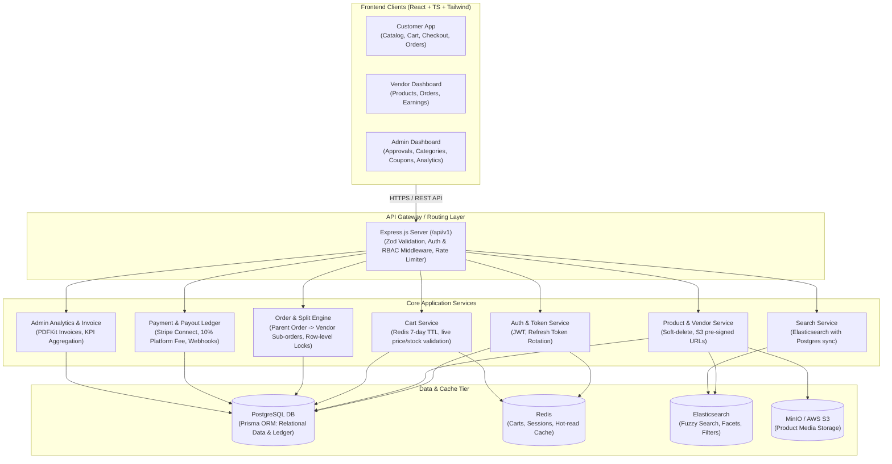
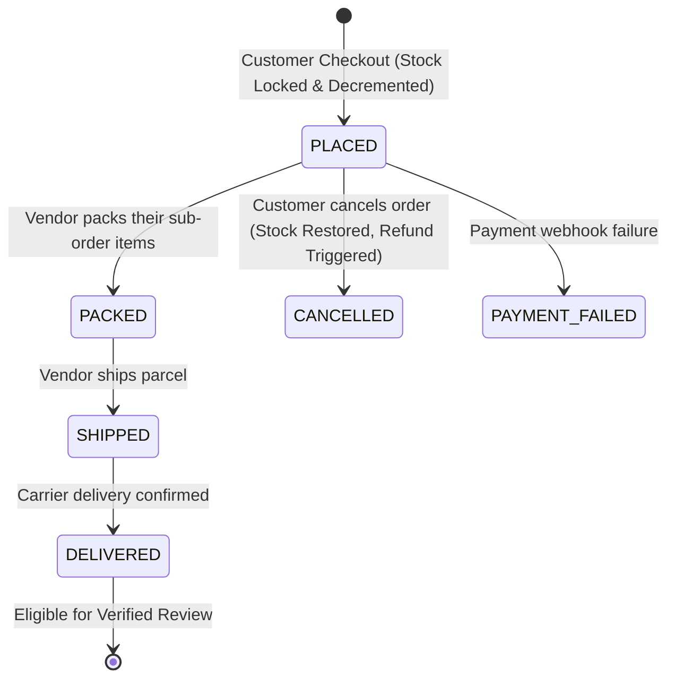
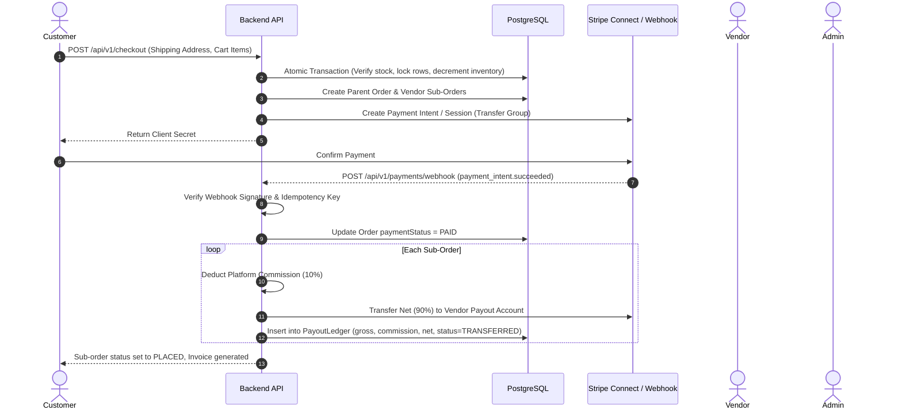

# System Architecture - Multi-Vendor E-Commerce Marketplace (FS-01)

## 1. High-Level Architecture Diagram

---

## 2. Order Lifecycle & Sub-order State Machine

---

## 3. Split Payment & Commission Flow

